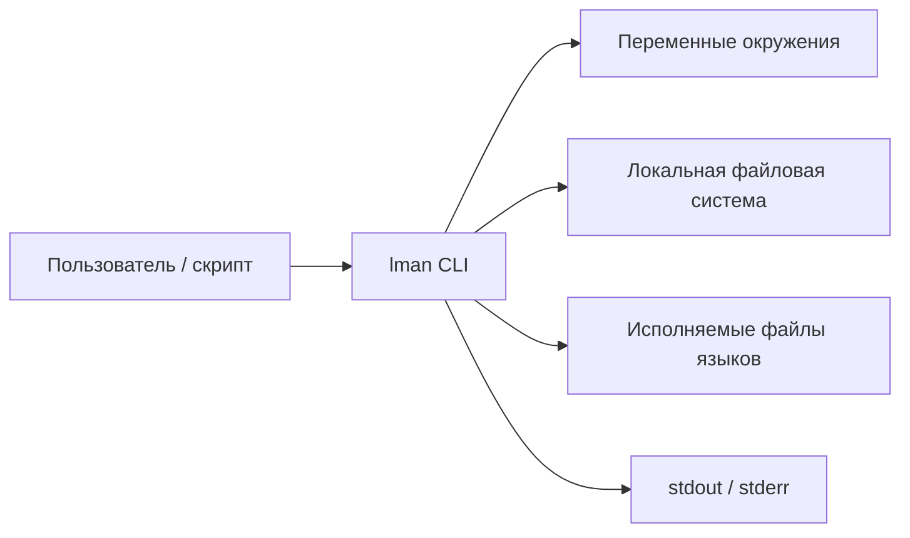
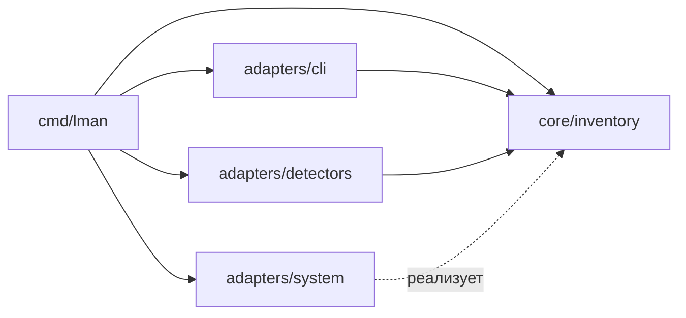

# Техническая архитектура `lman`

## 1. Статус

Документ описывает целевую архитектуру read-only MVP и точки расширения для roadmap. Архитектурные решения становятся обязательными после начала реализации и изменяются через отдельные ADR.

## 2. Архитектурный стиль

Выбран **модульный монолит с Ports and Adapters**.

Это каноничный вариант для Go CLI такого размера:

- один статически собранный бинарный файл;
- тонкий CLI-слой без бизнес-логики;
- ядро организовано по бизнес-возможностям, а не по техническим слоям;
- модели, сценарии и порты одной возможности находятся в одном core-пакете;
- работа с ОС и конкретными языками изолирована в адаптерах;
- зависимости собираются явно в `main`;
- нет runtime-плагинов, DI-контейнера, event bus и сетевых сервисов.

Архитектура сохраняет простоту MVP, но позволяет добавлять языки и будущие изменяющие операции без переписывания CLI.

## 3. Архитектурные цели

- Гарантировать read-only поведение текущего этапа.
- Изолировать различия языков, ОС и способов установки.
- Обеспечить детерминированный вывод при параллельном сканировании.
- Позволить тестировать сценарии без реальной файловой системы и запуска процессов.
- Не связывать доменную модель с CLI-фреймворком.
- Ограничивать время и количество запускаемых внешних процессов.
- Сохранять один бинарный файл без обязательной конфигурации и сети.

## 4. Ограничения

- Язык реализации: Go.
- Поддерживаемые ОС MVP: Linux и macOS.
- Все операции MVP выполняются только на чтение.
- Полное рекурсивное сканирование файловой системы запрещено.
- Сетевой доступ в MVP отсутствует.
- Контекст передается первым параметром во все потенциально блокирующие операции.
- Каждая запущенная goroutine и дочерний процесс должны иметь ограниченный жизненный цикл.

## 5. Контекст системы



`lman` не обращается к удаленным сервисам и не изменяет окружение или локальные файлы.

## 6. Логические компоненты

### 6.1. Inventory Core

`internal/core/inventory` содержит все элементы текущей бизнес-возможности:

- модели языка, установки, конфигурации и результата сканирования;
- инварианты и доменные ошибки;
- сценарии `ListLanguages`, `DescribeLanguage`, `ListConfigs`;
- интерфейс детектора языка;
- интерфейс определения активного исполняемого файла, потребляемый inventory-сервисом.

Сервис inventory отвечает за:

- оркестрацию детекторов;
- ограниченный параллелизм;
- агрегацию частичных результатов и предупреждений;
- дедупликацию и стабильную сортировку;
- определение активной установки через системные порты.

`core/inventory` зависит только от стандартной библиотеки. Он не импортирует Cobra, адаптеры ОС или конкретные детекторы.

Будущие возможности `installation` и `activation` получат отдельные пакеты внутри `internal/core` только при начале соответствующих этапов roadmap. Пустые пакеты заранее не создаются.

### 6.2. CLI Adapter

`internal/adapters/cli` является входным, driving-адаптером:

- разбирает команды и аргументы;
- выполняет базовую валидацию синтаксиса;
- вызывает один сценарий `core/inventory`;
- преобразует результат в текстовое представление;
- пишет результат в `stdout`, диагностику в `stderr`;
- отображает доменные ошибки в коды завершения.

CLI не ищет файлы, не запускает языковые команды и не определяет активную установку.

Для дерева команд рекомендуется `github.com/spf13/cobra`. Зависимость используется только внутри `internal/adapters/cli`.

### 6.3. Language Detector Adapters

Каждый язык реализуется отдельным выходным, driven-адаптером в `internal/adapters/detectors/<language>`. Детектор знает:

- имена исполняемых файлов;
- стандартные каталоги Linux и macOS;
- способ безопасно получить версию;
- известные пользовательские и системные конфигурации.

Детектор реализует интерфейс из `core/inventory`, но не зависит от CLI. Узкие интерфейсы файловой системы, окружения и запуска процессов определяются внутри конкретного пакета детектора как на стороне потребителя.

### 6.4. System Adapters

`internal/adapters/system` реализует доступ к ОС:

- чтение `PATH` и переменных окружения;
- проверку существования и метаданных файлов;
- разрешение символьных ссылок;
- получение идентичности физического файла;
- `LookPath`;
- запуск процесса с тайм-аутом и ограниченным выводом;
- определение ОС, архитектуры и домашнего каталога.

Системные адаптеры не содержат правил конкретного языка.

## 7. Рекомендуемая структура репозитория

```text
.
├── cmd/
│   └── lman/
│       └── main.go                 # composition root и запуск
├── internal/
│   ├── core/
│   │   └── inventory/
│   │       ├── model.go             # модели и значения
│   │       ├── service.go           # сценарии использования
│   │       ├── detector.go          # потребляемый интерфейс детектора
│   │       ├── resolver.go           # порт определения активности
│   │       └── errors.go
│   └── adapters/
│       ├── cli/
│       │   ├── root.go              # команды Cobra
│       │   ├── list.go
│       │   ├── language.go
│       │   ├── configs.go
│       │   ├── text.go
│       │   └── exit.go
│       ├── detectors/
│       │   ├── golang/
│       │   │   └── detector.go
│       │   ├── java/
│       │   │   └── detector.go
│       │   └── python/
│       │       └── detector.go
│       └── system/
│           ├── filesystem.go
│           ├── environment.go
│           └── command.go
├── docs/
├── go.mod
└── go.sum
```

Тесты располагаются рядом с кодом. Общие пакеты `util`, `common`, `helpers` и `misc` не создаются.

Отдельный `internal/root` не нужен: для MVP все зависимости явно собираются в `cmd/lman/main.go`. Пакет можно выделить только если composition root перестанет помещаться в небольшой функции.

## 8. Направление зависимостей



Правила:

- `main` является единственным composition root.
- CLI и детекторы зависят от `core/inventory`; core не импортирует adapters.
- Системные адаптеры могут зависеть только от стандартной библиотеки и структурно реализовывать интерфейсы потребителей.
- CLI вызывает inventory-сервис, но inventory не знает о CLI.
- Конкретный детектор реализует интерфейс, определенный его потребителем.
- Интерфейсы размещаются рядом с потребителем, а не в общем пакете `ports`.
- Модели inventory не импортируют Cobra, адаптеры или форматтеры.
- Новая крупная возможность получает отдельный пакет в `core`, а не добавляется в существующий пакет формально похожего слоя.
- Глобальное изменяемое состояние запрещено.

## 9. Концептуальная доменная модель

Ниже приведена форма данных, а не фиксированный публичный Go API:

```go
type Installation struct {
	Language   LanguageID
	Version    string
	Path       string
	RealPath   string
	Active     bool
	VersionErr error
}

type ConfigPath struct {
	Language LanguageID
	Path     string
	Scope    ConfigScope
}

type ScanResult struct {
	Installations []Installation
	Configs       []ConfigPath
	Warnings      []Warning
}
```

Ожидаемые ошибки определения версии хранятся как диагностические данные только там, где необходимо вернуть частичный результат. Фатальные ошибки сценария возвращаются обычным `error`.

## 10. Контракт детектора

Интерфейс детектора языка в `internal/core/inventory` должен предоставлять две независимые операции:

```go
type Detector interface {
	Language() LanguageID
	Discover(ctx context.Context) ([]Installation, []Warning, error)
	Configs(ctx context.Context) ([]ConfigPath, []Warning, error)
}
```

Точный интерфейс уточняется при реализации первого вертикального среза. Обязательные свойства:

- детектор не изменяет систему;
- детектор не выполняет сетевые запросы;
- каждый внешний процесс запускается через общий ограниченный runner;
- ошибка одного кандидата возвращается предупреждением;
- ошибка, делающая результат детектора недостоверным целиком, возвращается как `error`.

## 11. Алгоритм обнаружения

Для каждого языка:

1. Получить кандидатов из `PATH` с сохранением приоритета.
2. Добавить кандидатов из ограниченного списка стандартных и пользовательских каталогов.
3. Нормализовать абсолютные пути.
4. Разрешить символьные ссылки.
5. Удалить дубли по идентичности физического файла; одного сравнения строковых путей недостаточно.
6. Для каждого уникального кандидата вызвать команду версии с тайм-аутом.
7. Нормализовать версию в адаптере языка.
8. Определить активную установку через результат системного `LookPath`.
9. Отсортировать результат по стабильному правилу.

Запрещено:

- рекурсивно обходить `/`, `/usr` или домашний каталог;
- доверять имени каталога как фактической версии;
- запускать неизвестный файл до проверки типа и права исполнения;
- считать первый найденный стандартный каталог активным без проверки `PATH`.

## 12. Определение активной установки

Источник истины MVP — фактическое разрешение команды текущим процессом:

1. получить путь через `LookPath` для основного исполняемого файла языка;
2. привести путь к абсолютному;
3. разрешить символьные ссылки;
4. сопоставить физический файл с обнаруженными установками.

Если shim стороннего менеджера скрывает физическую установку, результат должен явно показывать shim и диагностический статус. Система не должна угадывать скрытую активную версию.

## 13. Частичные результаты и ошибки

Ошибки разделяются на категории:

- ошибка использования CLI;
- неподдерживаемый язык;
- корректный пустой результат;
- частичный результат с предупреждениями;
- фатальная ошибка сканирования.

Правила:

- ошибки оборачиваются контекстом через `%w`;
- ошибки проверяются сразу после вызова;
- `panic` не используется для штатных ситуаций;
- предупреждение отдельного кандидата не уничтожает остальные результаты;
- отображение категории ошибки в exit code выполняется только в CLI-слое.

Точные числовые коды фиксируются отдельным CLI-контрактом до релиза.

## 14. Конкурентность

Сканирование разных языков может выполняться параллельно, но параллелизм должен быть ограничен:

- один общий лимит активных детекторов;
- отдельный небольшой лимит запуска процессов определения версии;
- `context.Context` отменяет ожидающие и активные операции;
- каждый процесс имеет тайм-аут;
- результаты сортируются после агрегации, поэтому порядок завершения goroutine не влияет на вывод;
- канал используется для передачи результатов, mutex — для простой общей статистики, если она потребуется.

Для MVP допустима последовательная реализация. Параллелизм добавляется только после измерения производительности.

## 15. Безопасность

- Нет сетевого доступа.
- Нет записи файлов.
- Не читается содержимое конфигураций.
- Вывод внешнего процесса ограничивается по размеру.
- Окружение дочернего процесса формируется явно и не содержит добавленных секретов.
- Пути из окружения считаются недоверенным вводом.
- Символьные ссылки и циклы обрабатываются безопасно.
- Диагностические логи не должны содержать содержимое конфигураций или значения чувствительных переменных.

## 16. Наблюдаемость

CLI не требует постоянной телеметрии. Достаточно:

- выключенного по умолчанию debug-режима;
- структурированной диагностики в `stderr`;
- длительности полного сканирования и отдельных детекторов в debug-режиме;
- причин пропуска кандидатов без вывода чувствительных данных.

Логи не являются частью стабильного `stdout`-контракта.

## 17. Тестовая стратегия

### Unit-тесты

- нормализация и дедупликация путей;
- парсинг версий каждого языка;
- стабильная сортировка;
- определение активной установки;
- агрегация частичных ошибок;
- отображение ошибок в коды завершения.

### Contract-тесты детекторов

Каждый детектор проверяется на общем наборе условий:

- установка в `PATH`;
- установка только в стандартном каталоге;
- несколько версий;
- символьная ссылка;
- неисполняемый файл;
- зависание или ошибка команды версии;
- неизвестный формат версии;
- отсутствие конфигураций.

### Integration-тесты

- временная файловая система;
- поддельные исполняемые файлы с контролируемым выводом;
- изолированный `PATH` и `HOME`;
- golden-тесты человекочитаемого вывода;
- проверка Linux и macOS в CI.

Тесты не должны зависеть от языков, реально установленных на машине разработчика или CI runner.

## 18. Порядок реализации

1. Composition root, CLI и один вертикальный сценарий `lman list`.
2. Порты файловой системы, окружения и запуска процессов.
3. Первый детектор языка с unit- и contract-тестами.
4. `lman <language>` и определение активности.
5. `lman <language> cfg`.
6. Дополнительные детекторы по одному, без общего преждевременного фреймворка.
7. Ограниченный параллелизм только при подтвержденной необходимости.

Рекомендуемый первый вертикальный срез — Go: у него однозначный исполняемый файл, стабильная команда версии и небольшой набор известных конфигураций.

## 19. Расширение для roadmap

Будущее управление версиями добавляется отдельными пакетами `core/installation` и `core/activation` и соответствующими write-адаптерами. Read-only детекторы не получают методов изменения.

Для изменяющего этапа дополнительно потребуются:

- отдельный интерфейс менеджера установок;
- доверенные источники и проверка артефактов;
- управляемый каталог;
- файловые блокировки;
- временная установка и атомарная публикация;
- журнал состояния для отката;
- политика взаимодействия с внешними менеджерами.

Разделение `Detector` и будущего `Manager` предотвращает случайное появление записи в текущих read-only сценариях.

## 20. Отклоненные альтернативы

### Runtime-плагины Go

Не выбраны из-за несовместимости версий Go, платформенных ограничений и усложнения доставки.

### Микросервисы

Не применимы: все данные локальны, сетевое взаимодействие не требуется.

### Единый универсальный детектор

Не выбран: способы установки, команды версий и конфигурации существенно различаются между языками.

### Полный файловый индекс

Не выбран из-за стоимости, проблем с правами и непредсказуемого времени выполнения.

### Сложный DDD

Не выбран: предметная область MVP мала. Достаточно явных типов, сценариев и адаптеров без агрегатов и репозиториев.
