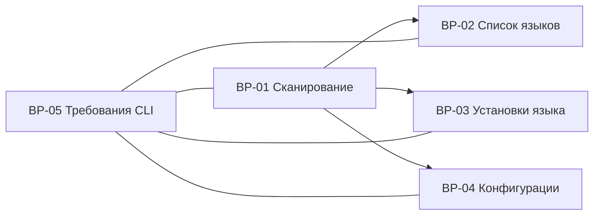

# Пользовательские сценарии

Документ показывает связи read-only процессов `BP-01..BP-05`.

## Карта процессов

## Сценарий 1. Получение списка языков

1. Пользователь запускает `lman list`.
2. Система сканирует известные локальные источники (`BP-01`).
3. Обнаруженные установки группируются по языку (`BP-02`).
4. Уникальный список выводится в стабильном порядке (`BP-05`).

## Сценарий 2. Просмотр установок языка

1. Пользователь запускает `lman <language>`.
2. Система обнаруживает все установки выбранного языка (`BP-01`).
3. Для каждой установки определяются версия и путь (`BP-03`).
4. Система определяет, какая установка разрешается текущим окружением.
5. Результат выводится с признаком активности (`BP-03`, `BP-05`).

## Сценарий 3. Просмотр конфигураций

1. Пользователь запускает `lman <language> cfg`.
2. Система получает известные системные и пользовательские пути (`BP-04`).
3. Система проверяет существование путей без чтения содержимого.
4. Найденные пути выводятся в стабильном порядке (`BP-04`, `BP-05`).

## Общие отказные ветки

- Неподдерживаемый язык: диагностика в `stderr`, ненулевой код завершения.
- Поддерживаемый язык без установок: однозначное сообщение об отсутствии установок.
- Недоступный каталог: предупреждение и продолжение сканирования остальных источников.
- Неопределимая версия: установка показывается с диагностическим статусом.
- Неоднозначная активность: система показывает конфликтующие пути и не выбирает активную установку произвольно.
- Конфигурации не найдены: команда возвращает пустой результат или согласованное информационное сообщение.

## Инварианты

- Ни один сценарий текущего этапа не изменяет файловую систему, конфигурации или окружение.
- Сценарии не требуют сети.
- Содержимое конфигурационных файлов не читается и не выводится.
- `stdout` содержит результат, `stderr` — предупреждения и ошибки.
